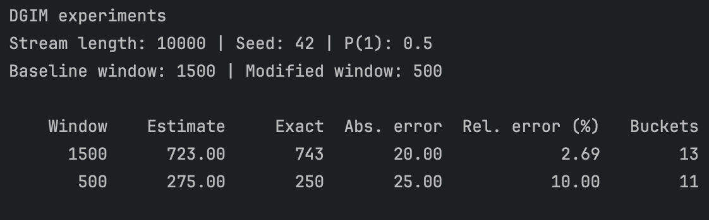

# DGIM Streaming Algorithm

A C++17 implementation of the DGIM algorithm.

## Requirements

- A C++17-compatible compiler
- CMake 3.31 or newer

## Build and Run

Run these commands from the project root:

```bash
cmake -S . -B build -DCMAKE_BUILD_TYPE=Release
cmake --build build
./build/DGIM-algorithm
```

## Example Results

Results for a 10,000-bit stream generated with seed 42, comparing
a baseline window of 1,500 bits with a modified window of 500 bits.


